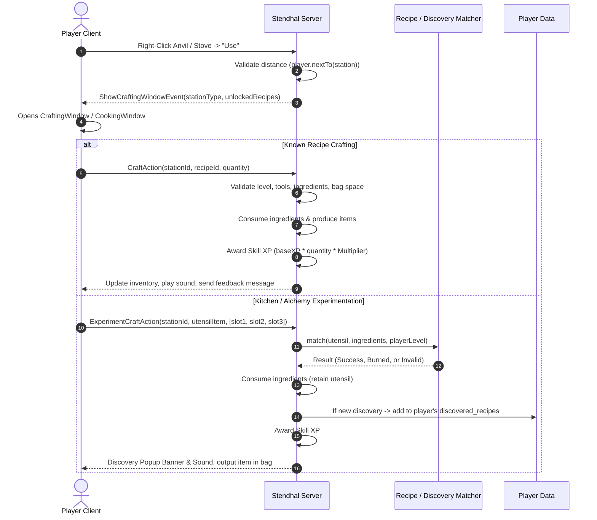
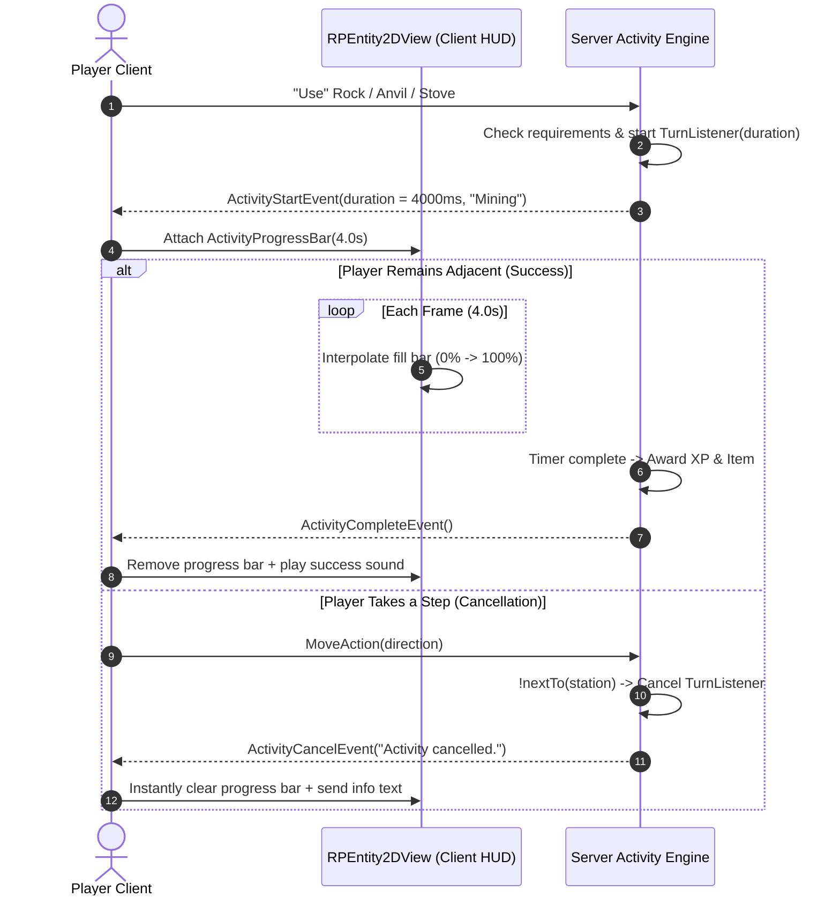

# Stendhal Life Skills, Crafting, Cooking & Alchemy Architecture

**Document Version:** 1.0  
**Author / Architect:** Senior Engine Architecture Team  
**Status:** Design Blueprint (Ready for Future Implementation)  
**Target Systems:** Life Skills Core Framework, World Crafting Stations, Smithing, Experimental Cooking, Alchemy & Recipe Discovery.

---

## Table of Contents
1. [System Overview & Architecture Goals](#1-system-overview--architecture-goals)
2. [Life Skills Core Engine Framework](#2-life-skills-core-engine-framework)
   - [2.1 Starting at Level 1](#21-starting-at-level-1)
   - [2.2 Capping Skills at Level 500](#22-capping-skills-at-level-500)
   - [2.3 Skill Multiplier Scaling](#23-skill-multiplier-scaling)
   - [2.4 Unified Skill Definition](#24-unified-skill-definition)
3. [World Entities: Interactive Crafting Stations](#3-world-entities-interactive-crafting-stations)
4. [Smithing & Deterministic Batch Crafting Subsystem](#4-smithing--deterministic-batch-crafting-subsystem)
5. [Experimental Cooking & Discovery Subsystem](#5-experimental-cooking--discovery-subsystem)
   - [5.1 Dual-Tab UI: Cookbook vs Kitchen](#51-dual-tab-ui-cookbook-vs-kitchen)
   - [5.2 Utensils as Recipe Catalysts](#52-utensils-as-recipe-catalysts)
   - [5.3 Order-Independent Recipe Matcher](#53-order-independent-recipe-matcher)
   - [5.4 Discovery & Failure Scenarios](#54-discovery--failure-scenarios)
6. [Alchemy & Potion Brewing Subsystem](#6-alchemy--potion-brewing-subsystem)
7. [Comprehensive Integration Map & Code Locations](#7-comprehensive-integration-map--code-locations)
   - [7.1 New Classes to Create](#71-new-classes-to-create)
   - [7.2 Existing Stendhal Files to Modify](#72-existing-stendhal-files-to-modify)
   - [7.3 Network Protocol & RPC Flow](#73-network-protocol--rpc-flow)
   - [7.4 Character Persistence & Database](#74-character-persistence--database)
8. [Woodcutting, Dynamic Tree Entities & Large Sprite View Frustum Architecture](#8-woodcutting-dynamic-tree-entities--large-sprite-view-frustum-architecture)
   - [8.1 The Multi-Tile Culling / Pop-Out Bug Explained](#81-the-multi-tile-culling--pop-out-bug-explained)
   - [8.2 Three Architectural Solutions](#82-three-architectural-solutions)
   - [8.3 Exact Stendhal Scripts & Files to Edit](#83-exact-stendhal-scripts--files-to-edit)
9. [Dedicated Life Skills GUI & RuneScape-Style Progression Guide](#9-dedicated-life-skills-gui--runescape-style-progression-guide)
   - [9.1 Sidebar Access Button](#91-sidebar-access-button)
   - [9.2 Dual-Column Window Layout](#92-dual-column-window-layout)
   - [9.3 Milestone Unlocks & Visual Feedback](#93-milestone-unlocks--visual-feedback)
10. [Future Economic Systems & Brainstorm Roadmap](#10-future-economic-systems--brainstorm-roadmap)
    - [10.1 Interconnected Skill Web](#101-interconnected-skill-web)
    - [10.2 Sustained Food Buffs](#102-sustained-food-buffs)
    - [10.3 Gathering Tool Tier Progression](#103-gathering-tool-tier-progression)
    - [10.4 Secondary Lucky Drops](#104-secondary-lucky-drops)
    - [10.5 In-Game Hall of Fame Leaderboards](#105-in-game-hall-of-fame-leaderboards)
11. [Skilling Overhead Progress Bar & Movement Cancellation Engine](#11-skilling-overhead-progress-bar--movement-cancellation-engine)
    - [11.1 Overhead Real-Time Progress Bar](#111-overhead-real-time-progress-bar)
    - [11.2 8-Tile Proximity & Movement Abort Mechanism](#112-8-tile-proximity--movement-abort-mechanism)
    - [11.3 Client-Server Event Protocol & Lifecycle](#113-client-server-event-protocol--lifecycle)
12. [Fishing Skill System & Dynamic Probability Scaling Engine](#12-fishing-skill-system--dynamic-probability-scaling-engine)
    - [12.1 Legacy Stendhal Fishing Analysis & Limitations](#121-legacy-stendhal-fishing-analysis--limitations)
    - [12.2 Hard Level Requirements & Fish Tiers](#122-hard-level-requirements--fish-tiers)
    - [12.3 Level-Scaled Catch Probability Formula](#123-level-scaled-catch-probability-formula)
    - [12.4 Quest & Karma Synergy](#124-quest--karma-synergy)

---

## 1. System Overview & Architecture Goals

```
+-----------------------------------------------------------------------------------+
|                                 CLIENT LAYER                                      |
|  [ StatsPanel ]   [ CraftingWindow (Smithing) ]   [ CookingWindow (Kitchen/Cookbook) ] |
+----------------------------------------+------------------------------------------+
                                         | Network RPC Actions & Events
                                         v
+-----------------------------------------------------------------------------------+
|                              SERVER VALIDATION LAYER                              |
|  - Proximity Check (nextTo)       - Required Tool / Utensil Validation            |
|  - Skill Level Gate               - Inventory Ingredient Consumption & Output     |
+----------------------------------------+------------------------------------------+
                                         |
                                         v
+-----------------------------------------------------------------------------------+
|                                ENGINE & DATA LAYER                                |
|  - SkillLevel Calculator (Lv 1..500)    - CraftingRegistry (Smithing / Cooking)  |
|  - Server XP Multiplier Scaling         - Player Attribute Discovery Persistence  |
+-----------------------------------------------------------------------------------+
```

### Core Architecture Pillars
1. **Zero Client Trust:** All recipes, ingredients, discovery logic, level requirements, and outputs are strictly validated and executed on the server.
2. **Modular & Data-Driven:** Adding new ores, bars, meals, or potions requires zero changes to GUI or networking logic; all stations adapt dynamically from registry data.
3. **Intuitive UX:** Polished UI matching the wood/Stendhal theme with instant search, drag-and-drop slots, batch craft sliders, and clear green/red requirement feedback.
4. **Richer Gameplay:** Moving beyond passive grinding to include **Experimentation**, **Recipe Discovery**, and **Utensil Modifiers**.

---

## 2. Life Skills Core Engine Framework

### 2.1 Starting at Level 1
* **Why Combat Starts at 10:** Stendhal's combat math uses raw numbers (`atk`, `def`). Level 10 was an offset to prevent division anomalies against level 1 creatures.
* **Life Skills Rule:** Life skills (Mining, Woodcutting, Fishing, Smithing, Cooking, Alchemy, Crafting, Fletching) start at **Level 1** (0 XP).
* **Level Formula:**
  $$\text{Skill Level} = 1 + \text{Level.getLevel}(\text{skill\_xp})$$
* **XP to Next Level:**
  $$\text{XP Remaining} = \text{Level.getXP}(\text{skillLevel}) - \text{skill\_xp}$$

### 2.2 Capping Skills at Level 500
* Stendhal's player level caps at 597 due to 32-bit integer limits on the cubic XP curve.
* Life skills are cleanly capped at **Level 500**:
  ```java
  public static final int MAX_LIFE_SKILL_LEVEL = 500;
  public static final int MAX_LIFE_SKILL_XP = Level.getXP(MAX_LIFE_SKILL_LEVEL - 1); // ~1.25 billion XP
  ```
* When `skill_xp >= MAX_LIFE_SKILL_XP`, effective level is clamped to 500, and client UI displays `(MAX)`.

### 2.3 Skill Multiplier Scaling
All life skills award XP through standard methods routed through the global server multiplier:
```java
public void incSkillXP(final SkillType skill, final int baseAmount) {
    final int gain = Math.max(1, Math.round(baseAmount * SERVER_SKILL_INCREASE));
    setSkillXP(skill, getSkillXP(skill) + gain);
}
```

### 2.4 Unified Skill Definition
```java
public enum LifeSkillType {
    MINING("miningLevel", "mining_xp", "Mining"),
    SMITHING("smithingLevel", "smithing_xp", "Smithing"),
    COOKING("cookingLevel", "cooking_xp", "Cooking"),
    ALCHEMY("alchemyLevel", "alchemy_xp", "Alchemy"),
    WOODCUTTING("woodcuttingLevel", "woodcutting_xp", "Woodcutting"),
    FISHING("fishingLevel", "fishing_xp", "Fishing"),
    CRAFTING("craftingLevel", "crafting_xp", "Crafting"),
    FLETCHING("fletchingLevel", "fletching_xp", "Fletching");

    public final String levelAttr;
    public final String xpAttr;
    public final String displayName;
}
```

---

## 3. World Entities: Interactive Crafting Stations

Crafting stations are map objects inheriting from `UseableEntity`:

```java
// Location: games.stendhal.server.entity.mapstuff.crafting
public class AnvilEntity extends UseableEntity {
    public AnvilEntity() {
        put("class", "station");
        put("name", "anvil");
        setMenu("Smith|Use");
        setDescription("A heavy iron anvil used for forging metal gear.");
    }

    @Override
    public boolean onUsed(final RPEntity entity) {
        if (!(entity instanceof Player)) return false;
        final Player player = (Player) entity;
        if (!player.nextTo(this)) {
            player.sendPrivateText("You are too far from the anvil.");
            return false;
        }
        player.sendEvent(new ShowCraftingWindowEvent("smithing", "Anvil", getID()));
        return true;
    }
}
```

### Station Types & Locations
* **`AnvilEntity` / `FurnaceEntity`:** Forging and Smelting (Semos Blacksmith, Ados Armory, Dwarf Mines).
* **`StoveEntity` / `CampfireEntity` / `CauldronEntity`:** Cooking & Baking (Taverns, Kitchens, Wilderness Camps).
* **`AlchemyLabEntity` / `AlembicEntity`:** Alchemy & Potions (Semos Apothecary, Wizard Towers).

---

## 4. Smithing & Deterministic Batch Crafting Subsystem

Smithing uses deterministic, known blueprint recipes categorized by metal tier, along with high-turnover consumable items (Whetstones, Infused Stones).

```java
public class CraftRecipe {
    private final String id;
    private final String category;           // e.g. "Iron Equipment", "Smelting", "Consumables"
    private final String resultItem;         // e.g. "iron sword", "magma_whetstone"
    private final int resultQuantity;        // e.g. 1
    private final Map<String, Integer> ingredients; // e.g. {"iron bar": 2, "wood": 1}
    private final int requiredLevel;         // e.g. 15
    private final String requiredTool;       // e.g. "hammer"
    private final int xpReward;              // e.g. 75 XP
}
```

### 4.1 Client UI Features
* **Left Panel:** Search box, category filter tabs, recipe table with item sprite, name, required level, and can-craft indicators.
* **Right Panel:** Selected item preview, ingredient checklist with bag counts (`Iron Bar: 4/2`), tool indicator (`[✓] Hammer equipped`), quantity slider/buttons (`[1]`, `[5]`, `[10]`, `[Max]`), and `[Smith]` action button.

---

### 4.2 Temporary Consumable Smithing: Whetstones & Sharpening Stones

Blacksmiths craft consumable sharpening items that apply temporary stat enhancements to equipped weapons.

#### A. Mechanics & Attribute Storage
When a player applies a Whetstone to their equipped weapon:
* Dynamic attributes stored directly on the weapon `RPObject`:
  * `weapon.put("honed_atk", 2);`
  * `weapon.put("honed_expire", System.currentTimeMillis() + (30 * 60 * 1000));` *(Time-based mode: 30 minutes)*
  * OR `weapon.put("honed_charges", 150);` *(Hit-based mode: 150 combat swings)*

#### B. Server Engine Resolution in `Item.java`
```java
public int getAttack() {
    int baseAtk = has("atk") ? getInt("atk") : 0;
    
    // Time-based expiration check
    if (has("honed_atk")) {
        if (has("honed_expire") && System.currentTimeMillis() < getLong("honed_expire")) {
            baseAtk += getInt("honed_atk");
        } else if (has("honed_charges") && getInt("honed_charges") > 0) {
            baseAtk += getInt("honed_atk");
        } else {
            remove("honed_atk");
            remove("honed_expire");
            remove("honed_charges");
        }
    }
    return baseAtk;
}
```

#### C. Server Performance Analysis (Hit-Charges vs Time)
* **Zero Overhead**: On every attack turn, the server already executes ammo subtractions, weapon deterioration checks (`weapon.deteriorate()`), hit rolls, damage variance, and status checks.
* Decrementing a memory integer (`charges--`) is a single CPU instruction (< 1 nanosecond) and introduces virtually **zero server strain**.
* **Hit-Based Advantage**: Ensures players don't lose their buff duration while traveling between dungeons.

---

### 4.3 Infused Smithing Stones & Elemental Damage Conversion

Blacksmiths can combine refined metal dusts, sulfur, and elemental reagents to forge **Infused Smithing Stones** that temporarily change the weapon's elemental damage type.

#### A. Synergy with Stendhal's `Nature` System
In Stendhal, damage types are governed by the `Nature` enum (`CUT`, `FIRE`, `ICE`, `LIGHT`, `DARK`):

```java
public Nature getDamageType() {
    if (has("infused_element")) {
        if (System.currentTimeMillis() < getLong("infused_expire")) {
            return Nature.parse(get("infused_element"));
        } else {
            remove("infused_element");
            remove("infused_expire");
        }
    }
    return this.damageType; // Default base damage type (CUT)
}
```

#### B. Infusion Tiers & Tactical Monster Vulnerabilities

| Infused Stone Item | Reagents | Elemental `Nature` | Ideal Monster Targets |
| :--- | :--- | :--- | :--- |
| **Magma Whetstone** | `Iron Bar` + `Coal` + `Sulfur` | `Nature.FIRE` | Ice Golems, Yetis, Treants (Takes **2.0x** Damage) |
| **Frost Whetstone** | `Silver Bar` + `Pure Water Vial` | `Nature.ICE` | Fire Elementals, Desert Scorpions (Takes **2.0x** Damage) |
| **Radiant Polish** | `Gold Bar` + `Holy Water` | `Nature.LIGHT` | Skeletons, Undead, Vampires, Demons (Takes **1.5x** Damage) |
| **Shadow Resin** | `Obsidian Dust` + `Poison Gland` | `Nature.DARK` | Celestial/Light Guardians, Humanoid Bandits |

#### C. Economic & Gameplay Value
* Creates an active economy where combat players commission Blacksmiths and Alchemists for specialized elemental stones before venturing into specific themed dungeons (e.g. packing Fire Stones before the Ice Dungeon).

---

## 5. Experimental Cooking & Discovery Subsystem

Cooking incorporates both **Known Recipe Batch Crafting** and **Free Kitchen Experimentation**.

### 5.1 Dual-Tab UI: Cookbook vs Kitchen

```
+-------------------------------------------------------------------+
|  [ 📖 Cookbook (Known Recipes) ]   [ 🍳 Kitchen Experimentation ]  |
+-------------------------------------------------------------------+
|                                                                   |
|   Utensil Slot:   [ 🍳 Frying Pan ] (Drag tool from inventory)     |
|                                                                   |
|   Ingredient Grid:                                                |
|   [ 🥩 Raw Meat ]  [ 🧅 Onion ]  [ 🧈 Butter ]  [ [ Empty ] ]     |
|                                                                   |
|   Preview: [ ❓ Unknown Recipe ]                                   |
|                                                                   |
|                   [ ♨️ COOK / EXPERIMENT ]                         |
+-------------------------------------------------------------------+
```

### 5.2 Utensils as Recipe Catalysts
Utensils are **never destroyed** during cooking; they act as the catalytic cooking method:

| Ingredients | Utensil | Output Dish | Req Level | Base XP |
| :--- | :--- | :--- | :--- | :--- |
| `Raw Meat` | **Spit / Skewer** | *Roasted Kebab* | 1 | 15 XP |
| `Raw Meat` | **Frying Pan** | *Pan-Seared Steak* | 5 | 30 XP |
| `Raw Meat` + `Water` + `Salt` | **Cooking Pot** | *Savory Meat Stew* | 12 | 80 XP |
| `Raw Meat` + `Flour` + `Butter` | **Baking Tray** | *Hearty Meat Pie* | 25 | 160 XP |
| `Milk` + `Sugar` + `Egg` | **Cooking Pot** | *Sweet Custard* | 8 | 45 XP |

### 5.3 Order-Independent Recipe Matcher
Ingredients placed in any order (e.g. `[Onion, Meat, Salt]` or `[Meat, Salt, Onion]`) match correctly via multiset comparison:

```java
public class CookingRecipeMatcher {
    public static CookingResult match(String utensil, List<String> inputs, int playerLevel) {
        CookingRecipe recipe = CookingRegistry.get().findByIngredients(utensil, inputs);

        // Scenario 1: No valid recipe matches the combination
        if (recipe == null) {
            return CookingResult.failure("Burnt Slop", 2, "These ingredients don't seem to work together.");
        }

        // Scenario 2: Valid recipe, but player level is too low
        if (playerLevel < recipe.getRequiredLevel()) {
            return CookingResult.burned("Burnt Food", 5, 
                "You need Cooking Level " + recipe.getRequiredLevel() + " to make this without burning it!");
        }

        // Scenario 3: Successful craft and discovery
        return CookingResult.success(recipe.getResultItem(), recipe.getResultQuantity(), recipe.getXpReward(), recipe.getId());
    }
}
```

### 5.4 Discovery & Failure Scenarios
1. **Discovery**: When an experiment succeeds, the server gives the food, awards XP, triggers a celebratory sound/banner (`"New Recipe Discovered: Savory Meat Stew!"`), and permanently adds the recipe ID to the player's `discovered_recipes` attribute.
2. **Burned**: Yields *"Burnt Food"*, grants minimal XP (e.g. 5 XP), and tells the player the required level.
3. **Invalid Combination**: Yields *"Burnt Slop"* / *"Dubious Food"*, consumes ingredients, and preserves the utensil.

---

## 6. Alchemy & Potion Brewing Subsystem

Alchemy follows the exact same experimental engine with alchemical equipment:

### Alchemical Utensils & Catalysts
* **`Glass Vial` / `Flask`:** Basic liquid container required for all potions.
* **`Mortar & Pestle`:** Used for grinding herbs and crushing mineral reagents into powders.
* **`Alembic / Distiller`:** For distilling essences, elixirs, and weapon oils.
* **`Cauldron`:** For boiling complex multi-herb concoctions.

### Example Alchemy Recipes

| Reagents | Apparatus | Output Potion | Req Level | Base XP |
| :--- | :--- | :--- | :--- | :--- |
| `Water Vial` + `Minor Healing Herb` | **Cauldron** | *Minor Health Potion* | 1 | 20 XP |
| `Water Vial` + `Healing Herb` + `Honey` | **Cauldron** | *Standard Health Potion* | 15 | 60 XP |
| `Alcohol Vial` + `Swift Leaf` + `Feather` | **Alembic** | *Potion of Swiftness (1.2x Speed)* | 25 | 110 XP |
| `Oil Flask` + `Poison Gland` + `Sulfur` | **Mortar & Pestle** | *Deadly Weapon Oil* | 40 | 200 XP |
| `Pure Water Vial` + `Dragon Blood` + `Obsidian Dust` | **Cauldron** | *Elixir of Dragon Might (+3 ATK Buff)* | 65 | 450 XP |

---

## 7. Comprehensive Integration Map & Code Locations

### 7.1 New Classes to Create

```
src/games/stendhal/
├── common/
│   └── skills/
│       ├── LifeSkillType.java              <- Enum of all life skills
│       └── SkillLevel.java                 <- Level 1..500 math, XP curves, and progress helpers
├── server/
│   ├── core/rp/crafting/
│   │   ├── CraftRecipe.java                <- Recipe model (ingredients, utensil, level, xp)
│   │   ├── CraftRegistry.java              <- Central registry for Smithing, Cooking, Alchemy
│   │   ├── CookingRecipeMatcher.java       <- Experimental multi-slot combination matcher
│   │   └── AlchemyRecipeMatcher.java       <- Alchemical reagent matcher
│   ├── actions/
│   │   ├── CraftAction.java                <- RPC action for known batch crafting
│   │   └── ExperimentCraftAction.java      <- RPC action for Kitchen/Alchemy experimentation
│   ├── events/
│   │   └── ShowCraftingWindowEvent.java    <- Event opening client crafting GUI
│   └── entity/mapstuff/crafting/
│       ├── AnvilEntity.java                <- Anvil map object
│       ├── FurnaceEntity.java              <- Smelting furnace map object
│       ├── StoveEntity.java                <- Kitchen stove map object
│       └── AlchemyLabEntity.java           <- Alchemy workstation map object
└── client/gui/crafting/
    ├── CraftingWindow.java                 <- Base themed crafting GUI
    ├── SmithingWindow.java                 <- Specialized Smithing view
    ├── CookingWindow.java                  <- Dual-tab Cooking view (Cookbook + Experiment)
    └── AlchemyWindow.java                  <- Dual-tab Alchemy laboratory view
```

---

### 7.2 Existing Stendhal Files to Modify

| File Path | Modifications Required |
| :--- | :--- |
| [`RPEntity.java`](file:///c:/Projetos/Stendhal/EmpireOfThorns/src/games/stendhal/server/entity/RPEntity.java) | Add `smithingLevel`, `smithing_xp`, `cookingLevel`, `cooking_xp`, `alchemyLevel`, `alchemy_xp` fields and `inc<Skill>XP()` methods with `SERVER_SKILL_INCREASE` multiplier scaling. |
| [`Player.java`](file:///c:/Projetos/Stendhal/EmpireOfThorns/src/games/stendhal/server/entity/player/Player.java) | In `createZeroLevelPlayer()`, initialize all life skills to `level = 1, xp = 0`. Add recipe discovery methods (`unlockRecipe()`, `hasUnlockedRecipe()`). |
| [`PlayerRPClass.java`](file:///c:/Projetos/Stendhal/EmpireOfThorns/src/games/stendhal/server/entity/player/PlayerRPClass.java) | Register RP attributes: `smithingLevel`, `smithing_xp`, `cookingLevel`, `cooking_xp`, `alchemyLevel`, `alchemy_xp`, `discovered_recipes`. |
| [`Level.java`](file:///c:/Projetos/Stendhal/EmpireOfThorns/src/games/stendhal/common/Level.java) | Reference `MAX_LIFE_SKILL_LEVEL = 500` for life skills. |
| [`StatsPanelController.java`](file:///c:/Projetos/Stendhal/EmpireOfThorns/src/games/stendhal/client/gui/stats/StatsPanelController.java) | Add property change listeners for new life skills and update remaining XP calculation: `Level.getXP(level) - xp`. |
| [`StatsPanel.java`](file:///c:/Projetos/Stendhal/EmpireOfThorns/src/games/stendhal/client/gui/stats/StatsPanel.java) | Add stat labels / tooltips for life skills in the client sidebar. |
| [`GenerateINI.java`](file:///c:/Projetos/Stendhal/EmpireOfThorns/src/games/stendhal/server/core/engine/GenerateINI.java) | Server setup wizard already includes global skill multiplier prompt. |

---

### 7.3 Network Protocol & RPC Flow



---

### 7.4 Character Persistence & Database

1. **Player Attributes in Marauroa:**
   - Discovered recipes are stored on the player RPObject as a comma-separated string attribute:
     ```java
     player.put("discovered_recipes", "meat_pie,seared_steak,savory_stew,swiftness_pot");
     ```
   - All life skill levels and XP values (`smithing_xp`, `cooking_xp`, `alchemy_xp`, etc.) are standard integer attributes on the `Player` RPObject, which are automatically serialized by `StendhalCharacterDAO` to the database on character save and logout.
2. **Data Integrity:**
   - If a new recipe is added in an update, existing players retain all their previously discovered recipes without requiring database migrations.
   - Quests and skill masters can also unlock recipes directly via `player.unlockRecipe("dragon_plate")`.

---

## 8. Woodcutting, Dynamic Tree Entities & Large Sprite View Frustum Architecture

This section documents the engine mechanics and solutions for RuneScape-style Woodcutting (trees that are chopped down, leave stumps, and regrow dynamically over time) without sprite pop-out or unrendering glitches.

### 8.1 The Multi-Tile Culling / Pop-Out Bug Explained

When static trees are drawn in Tiled (`.tmx` maps), they are rendered per-tile row-by-row on the screen. However, when converted to dynamic entities by adapting crop systems (`GrowingPassiveEntityRespawnPoint` / `PlantGrower`), a visual glitch occurs:

1. **The 1x1 Logical Bounding Box Mismatch:**
   - Crop classes inherit `setSize(1, 1)` (a 32x32 pixel collision and perception box at anchor $(x, y)$).
   - When a 4x4 tile tree sprite (128x128 pixels) is attached to a 1x1 entity, the engine only tracks the base trunk tile.
2. **Client-Side Frustum Culling:**
   - When the player walks upwards, the camera scrolls up.
   - The moment the base trunk tile $(x, y)$ crosses just 1 pixel beyond the bottom edge of the viewport, the client renderer flags the entity as "off-screen" and culls the **entire 128x128 sprite in a single frame**, causing the top leaves to abruptly vanish rather than clipping row-by-row.
3. **Server-Side Perception Boundary (Marauroa):**
   - Marauroa sends entity addition and removal packets based on the anchor coordinate. When $(x, y)$ exits the player's perception grid, the server tells the client to delete the entity completely.

---

### 8.2 Three Architectural Solutions

#### Solution A: Proper Multi-Tile Bounding Box (`setSize(w, h)`)
Instead of inheriting the 1x1 crop size, declare the tree entity with its full multi-tile dimensions:
```java
public class DynamicTreeEntity extends UseableEntity {
    public DynamicTreeEntity(final String type, final int width, final int height) {
        super();
        setSize(width, height); // e.g. setSize(3, 4) or setSize(4, 4)
        put("class", "tree");
        put("subclass", type);
        setMenu("Chop down|Use");
    }
}
```
* **Result:** Both the server's perception box and the client's viewport culling check the entire `(x, y, width, height)` bounding rectangle, keeping the leaves visible until the entire canopy is truly off-screen.

#### Solution B: Visual Bounds Expansion in `Entity2DView.java`
In the client's 2D rendering pipeline, update `Entity2DView` so that visibility and culling checks account for the sprite's actual pixel dimensions and alignment offsets:
```java
// Location: games.stendhal.client.gui.j2d.entity.Entity2DView.java
public Rectangle getVisualBounds() {
    final Sprite sprite = getSprite();
    if (sprite == null) {
        return new Rectangle(x, y, entity.getWidth() * 32, entity.getHeight() * 32);
    }
    return new Rectangle(x - xoffset, y - yoffset, sprite.getWidth(), sprite.getHeight());
}
```
* **Result:** Even if an entity has a smaller logical/collision footprint (e.g. 1x1 trunk base so players can walk behind the leaves), the renderer will never cull the sprite as long as any part of `getVisualBounds()` intersects the screen.

#### Solution C: Decoupled Interactive Stump + Canopy State Machine
A senior pattern separating the physical interaction base from the graphical canopy:
* **Interactive Base (`TreeStumpEntity`):** A 1x1 or 2x1 `UseableEntity` at the trunk base where the player clicks to chop. Handles tool checks (axes), chopping progress, wood drop, and respawn timer.
* **Graphical States (`StateEntity`):**
  - State 0: `FULL_CANOPY` (Healthy, harvestable tree)
  - State 1: `FALLING_ANIMATION` (Animated falling tree frames on chop)
  - State 2: `BARE_STUMP` (Remaining stump during cooldown)
  - State 3: `SAPLING_SPROUT` (Regrowing stage 1)
  - State 4: `YOUNG_TREE` (Regrowing stage 2 -> transitions back to State 0)

---

### 8.3 Exact Stendhal Scripts & Files to Edit

#### Server-Side Scripts (Entity, Spawning & Woodcutting Logic)
| File Path | Responsibility & Modification |
| :--- | :--- |
| [`TreeGrower.java`](file:///c:/Projetos/Stendhal/EmpireOfThorns/src/games/stendhal/server/entity/mapstuff/spawner/TreeGrower.java) | Existing tree grower script. Modify constructor to pass true multi-tile dimensions (`width, height`) instead of hardcoded `1, 1`. |
| [`GrowingPassiveEntityRespawnPoint.java`](file:///c:/Projetos/Stendhal/EmpireOfThorns/src/games/stendhal/server/entity/mapstuff/spawner/GrowingPassiveEntityRespawnPoint.java) | Base growing spawner. Ensure `max_ripeness`, `ripeness`, and stage change events support custom tree sprites and state transitions. |
| [`WoodSource.java`](file:///c:/Projetos/Stendhal/EmpireOfThorns/src/games/stendhal/server/entity/mapstuff/useable/WoodSource.java) | Wood gathering activity entity. Connect axe tool checks, woodcutting level checks, and wood drops. |
| [`Entity.java`](file:///c:/Projetos/Stendhal/EmpireOfThorns/src/games/stendhal/server/entity/Entity.java) | Manages entity bounding boxes (`setSize(w, h)`), passability/collision bounds, and zone placement. |
| [`StendhalRPZone.java`](file:///c:/Projetos/Stendhal/EmpireOfThorns/src/games/stendhal/server/core/engine/StendhalRPZone.java) | Server perception engine. Governs which entities are visible to players based on zone coordinates and perception bounds. |

#### Client-Side Scripts (Rendering & Viewport Frustum)
| File Path | Responsibility & Modification |
| :--- | :--- |
| [`Entity2DView.java`](file:///c:/Projetos/Stendhal/EmpireOfThorns/src/games/stendhal/client/gui/j2d/entity/Entity2DView.java) | Primary 2D entity view. Modify culling and bounding box methods (`getBounds()`, `intersectsView()`) to use sprite pixel dimensions (`sprite.getWidth()`, `sprite.getHeight()`, `yoffset`). |
| [`PlantGrower2DView.java`](file:///c:/Projetos/Stendhal/EmpireOfThorns/src/games/stendhal/client/gui/j2d/entity/PlantGrower2DView.java) | 2D view for plant and crop growers. Adjust cursor and Z-index layering (`getZIndex()`) so player sprites render behind canopies but in front of trunks. |
| [`StateEntity2DView.java`](file:///c:/Projetos/Stendhal/EmpireOfThorns/src/games/stendhal/client/gui/j2d/entity/StateEntity2DView.java) | 2D view for multi-state entities. Selects sprite frame/row based on the `state` attribute (Full Tree, Falling, Stump, Sapling). |
| [`GameScreen.java`](file:///c:/Projetos/Stendhal/EmpireOfThorns/src/games/stendhal/client/GameScreen.java) | Main game viewport renderer. Handles camera panning, screen coordinate transformations, and entity draw passes. |
| [`GameScreenSpriteHelper.java`](file:///c:/Projetos/Stendhal/EmpireOfThorns/src/games/stendhal/client/GameScreenSpriteHelper.java) | Screen coordinate conversions, scaling, and viewport bounds math (`getScreenViewX()`, `getScreenViewY()`). |

---

## 9. Dedicated Life Skills GUI & RuneScape-Style Progression Guide

### 9.1 Sidebar Access Button
In Stendhal's left HUD panel (below the Minimap and Player Stats area):
* Add a dedicated button: **`[⛏️ Life Skills]`** (or icon button in the action bar next to the Travel Log / Bag / Options).
* Clicking the button opens the dedicated **`LifeSkillsWindow`** modal dialog.

---

### 9.2 Dual-Column Window Layout

Inspired by the RuneScape Skill Guide and Stendhal's Travel Log ([`ProgressLog.java`](file:///c:/Projetos/Stendhal/EmpireOfThorns/src/games/stendhal/client/gui/progress/ProgressLog.java)):

```
+-----------------------------------------------------------------------------------------------+
| ⛏️ Life Skills & Milestone Guide                                                           [X] |
+---------------------------------------------------------------+-------------------------------+
|  ALL LIFE SKILLS (Click to inspect)                           |  MINING PROGRESSION GUIDE     |
|                                                               |  Current Level: Lv. 42 / 500  |
|  [⛏️ Mining]          Lv. 42 / 500  [████████░░░░] 68%       |                               |
|                      12,450 / 15,200 XP                       |  [✓] Lv. 1: Copper & Tin Ore  |
|                                                               |      Stone Pickaxe            |
|  [🔨 Smithing]        Lv. 28 / 500  [█████░░░░░░░] 45%       |                               |
|                      4,800 / 6,500 XP                         |  [✓] Lv. 15: Iron Ore         |
|                                                               |      Iron Pickaxe             |
|  [🍳 Cooking]         Lv. 35 / 500  [███████░░░░░] 54%       |                               |
|                      7,900 / 11,000 XP                        |  [✓] Lv. 30: Silver Ore       |
|                                                               |      Coal Veins, Steel Pick   |
|  [🧪 Alchemy]         Lv. 12 / 500  [███░░░░░░░░░] 22%       |                               |
|                      1,100 / 2,400 XP                         |  ---------------------------  |
|                                                               |  [🔒] Lv. 50: Sapphire & Ruby |
|  [🪓 Woodcutting]     Lv. 50 / 500  [██████████░░] 85%       |       Reinforced Steel Pick   |
|                      22,000 / 24,000 XP                       |                               |
|                                                               |  [🔒] Lv. 60: Gold Ore        |
|  [🎣 Fishing]         Lv. 19 / 500  [████░░░░░░░░] 38%       |       Gold Pickaxe            |
|                      2,200 / 4,100 XP                         |                               |
|                                                               |  [🔒] Lv. 80: Mithril Ore     |
|  [🌾 Farming]         Lv. 5 / 500   [█░░░░░░░░░░░] 10%       |       Obsidian Pickaxe        |
|                      300 / 800 XP                             |                               |
|                                                               |  [🔒] Lv. 100: Adamantite     |
|  [🧵 Crafting]        Lv. 1 / 500   [░░░░░░░░░░░░] 0%        |       Dragon Bone Pickaxe     |
|                      0 / 50 XP                                |                               |
+---------------------------------------------------------------+-------------------------------+
```

---

### 9.3 Milestone Unlocks & Visual Feedback

When the player selects a skill on the left:
1. **Header**: Shows current skill level, total XP, XP needed for next level, and overall rank.
2. **Milestone Item Cards**:
   * **Unlocked Milestones (`playerLevel >= milestoneLevel`)**:
     * Vivid, crisp, full-color item sprite and text.
     * Highlighted border with a green checkmark badge `[✓]`.
   * **Locked Milestones (`playerLevel < milestoneLevel`)**:
     * Semi-transparent grey overlay (e.g. 40% alpha).
     * Lock icon badge `[🔒]` indicating the level required to unlock.
     * Allows players to clearly see what goals, ores, tools, and dishes lie ahead to motivate grinding.

#### Files to Implement:
* **Client UI**: `games.stendhal.client.gui.skills.LifeSkillsWindow.java` and `SkillProgressionPanel.java`.
* **Sidebar Integration**: `games.stendhal.client.gui.ScreenController.java` / `games.stendhal.client.gui.stats.StatsPanel.java`.
* **Milestone Registry**: `games.stendhal.common.skills.SkillMilestones.java` (stores unlock level tables per skill).

---

## 10. Future Economic Systems & Brainstorm Roadmap

*(Lowest Priority - To be explored after core life skills are established)*

### 10.1 Interconnected Skill Web
* **Mining** supplies Ores $\rightarrow$ **Smithing** (Bars, Weapons, Armor, Tools).
* **Mining** supplies Gems/Sulfur $\rightarrow$ **Alchemy** & **Crafting**.
* **Woodcutting** supplies Logs/Charcoal $\rightarrow$ Fuel for Smelting Furnaces & Campfire Cooking.
* **Woodcutting** supplies Wood Planks $\rightarrow$ **Fletching** (Bows, Crossbows, Arrow Shafts).
* **Fishing & Farming** supply Raw Fish, Grain, Herbs $\rightarrow$ **Cooking** & **Alchemy**.

### 10.2 Sustained Food Buffs (The "Well-Fed" State)
Cooking produces meals that grant long-term (15–30 min) non-combat and combat buffs:
* *Savory Stew*: `+15% Out-of-combat HP Regeneration`.
* *Fisherman's Platter*: `+10 Maximum Carry Weight`.
* *Spiced Kebab*: `+1 Passive Melee Hit Damage`.
* *Honey Pastry*: `+10% Faster Mana Regeneration`.

### 10.3 Gathering Tool Tier Progression
Tools scale with skill level to increase harvest speed and unlock double-drop chances:
* **Bronze Pick/Axe** (Lv 1): 8.0s duration, base yield.
* **Iron Pick/Axe** (Lv 15): 6.5s duration, +5% double-yield chance.
* **Steel Pick/Axe** (Lv 30): 5.0s duration, +10% double-yield chance.
* **Mithril Pick/Axe** (Lv 50): 3.5s duration, +15% double-yield + rare gem/nest find.
* **Volcanic / Dragon** (Lv 80+): 2.0s duration, instant harvest chance.

### 10.4 Secondary Lucky Drops
Gathering occasionally awards bonus items:
* **Mining**: Uncut Gems, Geodes (cracked open at an anvil), Fossils.
* **Woodcutting**: Bird Nests (seeds, feathers, rings), Tree Sap/Resin.
* **Fishing**: Sunken Clams (pearls), Waterlogged Strongboxes (coins/keys).

### 10.5 In-Game Hall of Fame Leaderboards
In town squares (Semos / Ados), leaderboard boards tracking the *"Top 10 Miners"*, *"Top 10 Blacksmiths"*, and *"Top 10 Chefs"* via `StendhalHallOfFameDAO`.

---

## 11. Skilling Overhead Progress Bar & Movement Cancellation Engine

### 11.1 Overhead Real-Time Progress Bar
When a player initiates any skilling activity (Mining a rock, Chopping a tree, Smelting at a furnace, Forging at an anvil, Cooking at a stove, Brewing at an alchemy lab):
* The server sends an `ActivityStartEvent(durationMillis, activityName)` to the client.
* The client attaches an **Overhead Progress Bar** (`ActivityProgressBar`) rendered directly above the player's head via [`RPEntity2DView.java`](file:///c:/Projetos/Stendhal/EmpireOfThorns/src/games/stendhal/client/gui/j2d/entity/RPEntity2DView.java).
* **Visual Presentation**:
  - Compact 32x6px bar styled with a dark wood border and vibrant deep sky blue progress fill (`Color(50, 150, 255)`).
  - Smooth 60 FPS client interpolation: $\text{Progress} = \frac{\text{currentTime} - \text{startTime}}{\text{durationMillis}}$.
  - Rendered **exclusively for the local player** so other players' screens remain clean.

```
          [ ⛏️ Mining: ████████░░ 75% ]
                      ( o_o )
                      / | \
                       / \
```

---

### 11.2 8-Tile Proximity (`nextTo`) & Movement Abort Mechanism
Players can naturally cancel any ongoing activity simply by **taking a step or clicking away**.

```java
// Location: games.stendhal.server.entity.mapstuff.useable.PlayerActivityEntity.java
public boolean isWithin8Tiles(final Player player) {
    return Math.abs(player.getX() - this.getX()) <= 1 && Math.abs(player.getY() - this.getY()) <= 1;
}

public void onPlayerMoved(final Player player) {
    if (!isWithin8Tiles(player)) {
        cancelActivity(player, "You moved away and stopped.");
    }
}
```

#### Key Advantages:
1. **Misclick Safety**: If a player accidentally crafts 10x of the wrong item or starts chopping the wrong tree, simply stepping 1 tile in any direction immediately aborts without losing additional materials.
2. **Combat Danger Reaction**: If an aggressive monster aggros and attacks the player while skilling, moving or running away instantly cancels the action and transitions the character into combat readiness.

---

### 11.3 Client-Server Event Protocol & Lifecycle



---

## 12. Fishing Skill System & Dynamic Probability Scaling Engine

### 12.1 Legacy Stendhal Fishing Analysis & Limitations
In legacy Stendhal ([`FishSource.java`](file:///c:/Projetos/Stendhal/EmpireOfThorns/src/games/stendhal/server/entity/mapstuff/useable/FishSource.java)):
* Fishing had a flat base chance of only **5%** before quests/karma.
* Fishing "skill" was stored as arbitrary floating strings from quiz quests rather than an actual progression system.
* High-tier catches were frustratingly rare and lacked clear level milestones.

---

### 12.2 Hard Level Requirements & Fish Tiers

Each fish species requires a hard minimum Fishing Level to attempt catching:

| Fish Species | Hard Req Level | Base Catch Chance | Base XP Reward | Cooking Synergy |
| :--- | :--- | :--- | :--- | :--- |
| **Small Minnow / Sardine** | Level 1 | 40% | 15 XP | Fried Sardines, Bait |
| **Trout / Perch** | Level 15 | 30% | 45 XP | Grilled Trout |
| **Salmon / Pike** | Level 35 | 25% | 110 XP | Smoked Salmon |
| **Lobster / Crab** | Level 50 | 20% | 180 XP | Boiled Lobster, Bisque |
| **Swordfish / Tuna** | Level 70 | 15% | 275 XP | Seared Tuna Steak |
| **Great White Shark** | Level 100 | 10% | 450 XP | Shark Fin Soup (+Stat Buff) |
| **Abyssal Kraken Tentacle** | Level 150 | 5% | 850 XP | Kraken Calamari (Endgame Raid Food) |

---

### 12.3 Level-Scaled Catch Probability Formula

Once the player meets the hard level requirement, their chance of catching that fish scales upwards with every additional Fishing Level gained:

$$\text{Catch Chance} = \text{Base Chance} + \big[(\text{Player Fishing Level} - \text{Fish Req Level}) \times \text{Level Scale Factor}\big] + \text{Quest Bonus} + \text{Karma Bonus}$$

#### Concrete Example: Catching a Great White Shark (Req Lv 100, Base 10%, Scale = 0.5%/lv)
* **Fishing Level 99:** `0%` (Hard locked - cannot attempt).
* **Fishing Level 100:** `10%` catch chance.
* **Fishing Level 120:** $10\% + (120 - 100) \times 0.5\% = \mathbf{20\%}$ catch chance.
* **Fishing Level 160:** $10\% + (160 - 100) \times 0.5\% = \mathbf{40\%}$ catch chance.
* **Fishing Level 220:** $10\% + (220 - 100) \times 0.5\% = \mathbf{70\%}$ catch chance (Clamped at 85% max cap).

---

### 12.4 Quest & Karma Synergy

1. **Permanent Quest Perks**:
   - Completing the *Fisherman's License Quiz* quest: Grants **+5% permanent catch probability**.
   - Completing the *Fisherman's Collector* quest: Grants **+5% permanent catch probability**.
2. **Karma Boost**:
   - `player.useKarma(0.05)`: Consumes a small amount of character karma on attempt to add a temporary **+5% boost**.
3. **Engine Implementation in `FishSource.java`**:
   ```java
   public double calculateCatchProbability(final Player player, final FishDefinition fish) {
       final int playerLevel = player.getFishingLevel();
       if (playerLevel < fish.getRequiredLevel()) {
           return 0.0; // Hard level locked
       }
       
       double prob = fish.getBaseProbability();
       final int levelDelta = playerLevel - fish.getRequiredLevel();
       prob += (levelDelta * 0.005); // +0.5% per level above requirement
       
       if (player.hasCompletedQuest("fishermans_license")) prob += 0.05;
       if (player.hasCompletedQuest("fishermans_collector")) prob += 0.05;
       prob += player.useKarma(0.05);
       
       return Math.min(0.85, Math.max(0.05, prob)); // Clamp between 5% and 85%
   }
   ```

---

### Summary Checklist for Future Implementation
- [ ] Define `LifeSkillType` and `SkillLevel` utility classes.
- [ ] Add skill attributes and Level 1 initialization to `Player.java` and `RPEntity.java`.
- [ ] Implement `CraftRecipe`, `CraftRegistry`, and `CookingRecipeMatcher`.
- [ ] Create `UseableEntity` stations (`AnvilEntity`, `StoveEntity`, `AlchemyLabEntity`).
- [ ] Implement `CraftAction` and `ExperimentCraftAction` server actions.
- [ ] Build the themed `CraftingWindow`, `CookingWindow`, and `AlchemyWindow` client UIs with drag-and-drop slots.
- [ ] Build the `LifeSkillsWindow` dual-column skill guide with milestone progression cards and greyed-out locked states.
- [ ] Add the sidebar `[Life Skills]` button under the player stats panel.
- [ ] Implement the `ActivityProgressBar` overhead casting bar (deep sky blue fill) in `RPEntity2DView.java`.
- [ ] Connect 8-tile proximity cancel on movement in `PlayerActivityEntity.java`.
- [ ] Update `FishSource.java` with hard level requirements and level-delta scaling catch probabilities.
- [ ] Connect `StatsPanelController` to track all life skills on the HUD.
- [ ] Implement `DynamicTreeEntity` with multi-tile bounding boxes and visual bounds culling in `Entity2DView.java`.
- [ ] Place initial stations and harvestable trees in Semos, Ados, and Dwarf Mines.

